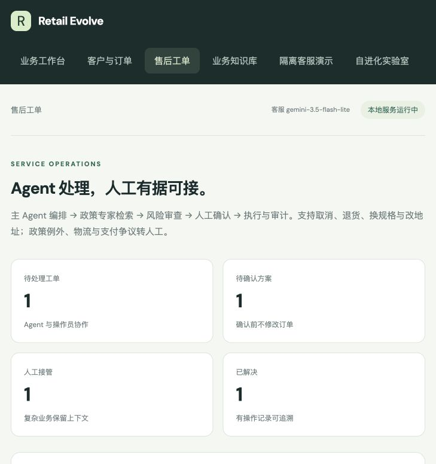
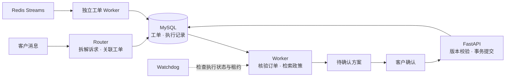
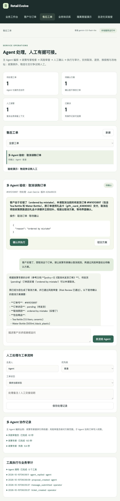
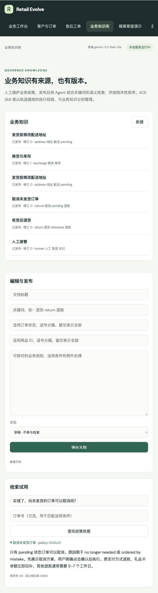

# Retail Evolve

**把售后对话推进到可确认、可追溯的订单操作。**

一个面向电商售后的客服 Agent 工作台，覆盖查单、取消订单、退换货和改收货地址。客户在同一个会话里提出或修改需求，系统按工单核对订单和政策、生成办理方案，并在客户确认后执行业务变更。




## 一次售后是怎么办完的

> 客户说「鞋子换成 42 码，耳机我想退掉」，看到方案后又说「鞋子还是换 43 码」。

Router 将两项诉求关联到不同工单。客户改口后，换货 Worker 根据新尺码继续核验订单、政策和商品规格，旧方案失效，耳机工单保留自己的进度。客户确认新方案时，FastAPI 后端复核工单与订单版本，再将业务变更、方案状态和审计写入同一笔 MySQL 事务。



统一客服入口由调度器按工单唤起 Worker。独立工单入口和实验任务分别使用 Redis Streams 处理后台消息。

## 项目看点

| 场景 | 设计与工程处理 |
| --- | --- |
| **同一会话处理多项售后** | Router 根据近期消息和已有工单拆解诉求，Worker 按工单加载业务上下文。对归属不清的消息先澄清，对同一工单的新消息使旧方案失效。 |
| **售后政策检索与溯源** | 按订单状态、商品及发布版本过滤条款，使用 BM25 和向量双路召回，经 RRF 融合与重排。返回条款来源，并在提交方案前复核引用。 |
| **审批、幂等与异常恢复** | 方案与订单变更分阶段处理。确认接口校验工单与订单版本，事务内保留审计记录。后台执行通过持久化状态和租约恢复中断任务。 |
| **轨迹驱动的离线改进** | **Harness Self-Improvement** 从失败轨迹生成候选补丁，经回归评测筛选版本。**Skill Self-Improvement** 从执行轨迹提炼策略，维护可按任务检索的版本化技能库。 |

<details>
<summary>查看方案确认和知识库页面</summary>

<table>
<tr><th>售后工单与方案确认</th><th>政策维护与检索</th></tr>
<tr>
<td valign="top"></td>
<td valign="top"></td>
</tr>
</table>

</details>

## 本地运行

需要 **Python 3.12**、**MySQL** 和编译 Redis 所需的 C 构建工具。安装脚本会创建虚拟环境并准备项目自己的 Redis。

```bash
git clone https://github.com/wuguidaxadad/retail-evolve.git
cd retail-evolve
python3.12 scripts/install.py
cp .env.example .env
```

在本地 `.env` 设置兼容 OpenAI 接口的地址、密钥和模型名，随后启动业务工作台。

```bash
.venv/bin/python scripts/start_local.py --product-only
```

打开 [售后工作台](http://127.0.0.1:8765/) 或 [API 文档](http://127.0.0.1:8765/docs)。演示数据取自公开零售模拟环境，订单变更在本地模拟数据中执行。可先选一笔待发货订单，发起取消申请，观察方案确认前后的订单状态及操作记录。

## 代码入口与评测

| 入口 | 内容 |
| --- | --- |
| [统一客服接口](app/support_api.py) · [任务路由](app/support_flow.py) | 会话、消息、Router、执行记录与 Worker 调度 |
| [售后执行](app/service.py) · [政策检索](app/service_retrieval.py) | 方案确认、事务更新、混合检索与版本校验 |
| [任务队列](app/queue.py) · [工单 Worker](app/service_worker.py) | Redis Streams、持久化投递与消费恢复 |
| [代码优化](app/full_rsi.py) · [技能优化](app/learning.py) | 候选补丁、回归门禁与版本化技能 |
| [业务回归用例](tests/test_support_router.py) | 验证跨轮改口、旧方案失效与任务恢复 |

离线实验在 τ²-bench Retail 上设计基线、Harness、Skill 三组对照，使用独立任务划分衡量改进效果。仓库提供实现、划分与回归用例。

本项目采用 [MIT 许可证](LICENSE)。第三方代码与基准的数据来源、版本及许可证见 [UPSTREAM.json](UPSTREAM.json) 和 [vendor](vendor/)。
